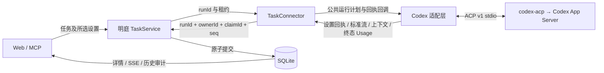
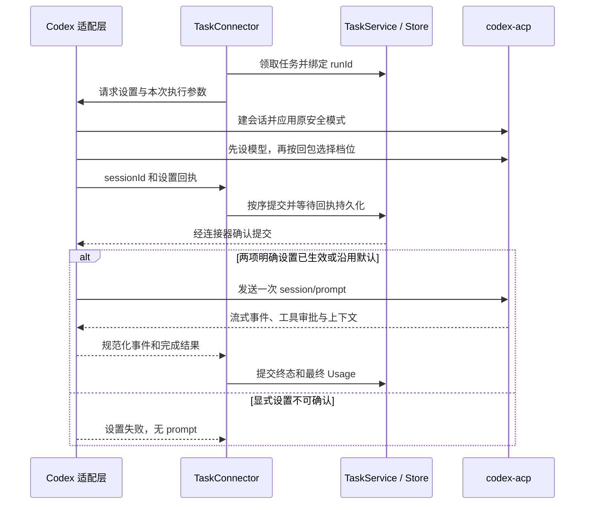

# Codex 任务设置、过程审计与用量对账 · 技术设计

> 功能依据：[已确认的 Spec](spec.md)，SHA-256 `c8c57813315cd04de932aaa97959c99572f7e72bc2cfd9ec7f870cf870876680`。
> 确认依据：2026-11-05 用户回复“Spec 确认，继续走 x-tech-design”。
> 设计版本：v0.2 · 已确认。范围为明庭普通 Codex 任务的单回合执行。本版明确 Usage 的公共结构与适配边界。
> 设计确认依据：2026-11-05 用户回复“然后技术文档没看出问题”。确认范围为文首四项技术决策。

## 需要判断的关键决策

| 选择 | 方案和理由 | 代价与影响 |
|---|---|---|
| 接入边界 | 沿用已接入的 `codex-acp 2.5.0`。Codex 的选项映射、回包和用量扩展由适配层解释。明庭接收统一的设置回执、指标和执行事件 | 保留现有依赖和运行方式。增加有限的扩展校验，适配器升级时需要对照测试 |
| 运行与提交 | 复用 `runId`、会话 ID 和报告顺序号。本期一 run 一 prompt。设置回执提交成功后才发 prompt，最终 Usage 和运行结果在同一事务提交 | 设置增加一次本机往返。重试仍创建新运行，历史值可以分开核对 |
| 用量口径 | `session/prompt` 回包中的 `usage` 对账主回合消耗，`usage_update` 展示上下文 | 可以核对适配器报告的主回合。辅助请求、订阅额度和实际账单各有独立证据边界 |
| 审计与选项发现 | 复用任务、运行、审批与实时流。用独立按运行分页的记录留存工具和上下文。连接器用无 prompt 的临时会话探测选项，执行前重验 | 增加一张审计表和内存能力快照。历史滚动删除的内容显示缺失 |

## 入口来源和现状

**`@agentclientprotocol/codex-acp` 是相对于 OpenAI 的第三方适配器，由 Agent Client Protocol 项目组织维护。底层 `codex app-server` 是 OpenAI 官方实现。** ACP 项目文档把 Codex 列为通过 ACP 项目适配器接入。明庭的 `runtime()` 已经启动本机安装的 2.5.0 包入口，使用 ACP v1 stdio 和项目内的账号配置。 [ACP 的 Codex 条目](https://agentclientprotocol.com/get-started/agents) · [2.5.0 发布](https://github.com/agentclientprotocol/codex-acp/releases/tag/v2.5.0) · [OpenAI App Server](https://developers.openai.com/codex/app-server) · [明庭运行入口](../../../src/server/runtime.ts#L128)

当前适配器负责会话、流、权限与清理。普通任务建会话后只设置固定安全模式，prompt 完成时只向连接器返回 `stopReason`。服务已按租约和顺序号提交运行状态。工具更新及上下文通知进入近期事件，网页主要显示当前 run。设计在这条已有路径上增加确认和持久记录。 [当前适配器](../../../src/server/codex-adapter.ts#L195) · [回报事务](../../../src/server/service.ts#L367) · [事件留存](../../../src/server/store.ts#L239)

## 统一层和适配层

| 职责 | 权威与写入方 | 计划位置与公开边界 |
|---|---|---|
| 任务设置、运行和权限 | 统一层保存请求、生成运行、校验会话与租约、裁决审批 | `shared/protocol.ts` 的 Zod 契约和 `TaskService`。Web、MCP、连接器使用同一套公共字段 |
| 执行与有序回传 | 连接器负责认领、保活、按序报告、审批等待 | `connector/connector.ts` 依赖共享执行契约。适配层负责 ACP 请求、流和进程清理 |
| Codex 专有语义 | 适配层解析模型选项和回执、Usage 扩展、上下文来源并转成公共数据 | 在 `server/codex-adapter.ts` 旁提取局部映射。标准 ACP 类型继续使用 SDK；扩展在边界从 `unknown` 用 Zod 校验 |
| 权威记录和查询 | `tasks` 持有请求，`runs` 持有生效回执和最终用量，`approvals` 持有原请求和决定，新增 `run_audit` 持有工具更新和上下文观测 | 服务是业务写入方。Web、SSE、历史查询消费服务端派生结果 |

依赖方向为入口 → 共享契约与服务 → Store，连接器 → 公共执行接口 ← 适配层。服务和网页无需读取 Codex 私有字段。现有普通审批保留标准 ACP 请求与选项 ID，其他执行器及独立唤醒路径兼容现有行为。

## 选项发现、回执与提交顺序

Codex 连接器注册成功后在空闲时用同一账号配置与工作区建立临时 ACP 会话。读取 `configOptions` 的模型列表，逐一切到候选模型并读取其档位。2.5.0 的模型选项只列模型，当前模型的档位在另一项返回。探测只变更临时会话，关闭会话后回收进程，整个探测沿用初始化时限。任务优先于探测。已注册的连接器上报规范化快照，服务按在线 `ownerId` 保存，通过原 harness 查询和网页快照提供模型/档位。断线丢弃该快照和旧探测结果。缺快照时原默认发布可用，界面标记显式选项暂不可发现。 [ACP 会话配置](https://agentclientprotocol.com/protocol/v1/session-config-options)

以真正执行的会话为准。模型切换可能自动改变档位，必须读取模型设置回包，再校验该模型支持的档位，最终同时核对实际模型与档位。只指定档位时以该会话实际默认模型校验。显式设置遭拒、回读不一致或提交失败，流程停在 prompt 前。默认任务记录已确认的实际值，未知留空。回执等待复用连接器报告链，失败回执与运行失败仍能追溯。回执表示发出 prompt 前的确认值。若运行中实际收到模型变更，保留独立事件，验收出现明确偏离时按差异处理。

推演：发布时选择 B/high。正式会话选中 B 后只提供 low、medium，则记录 B/high 及失败原因，prompt 数为 0。B/high 都被确认时，提交成功后才发送一次 prompt。 [回执屏障用例](#t03)

## Usage 与上下文的权威口径

明庭用执行器无关的 `RunUsage` 作为持久化、任务汇总和 Web 渲染的公共契约。各执行器的适配层按已验证的版本解释原始字段并转换，记录字段含义、累计范围和来源。Codex 是本期唯一生产者。Web 用公共计数、覆盖状态和来源标签展示，按执行器分支解析原始回包的逻辑留在适配层。

ACP 已给上下文提供可选的标准 `usage_update`。回合消耗还有不稳定字段。ACP 的迁移指南将 v1 不稳定的 `PromptResponse.usage` 对应到 v2 不稳定的 idle `state_update.usage`。字段相似时，仍需验证单回合、会话累计、缓存包含关系以及缺项。标准数据可直接映射，厂商扩展在适配层转换。 [ACP v1 上下文用量](https://agentclientprotocol.com/protocol/v1/prompt-turn#session-usage-updates) · [ACP v2 迁移指南](https://agentclientprotocol.com/protocol/v2/migration)

### 四家执行器的输入对照

以下为协议选型证据。适配器比较以标注版本、源码及现有实测为界。本期只实现 Codex 映射。

| 入口 | 回合消耗 | 上下文和映射边界 |
|---|---|---|
| Codex `codex-acp 2.5.0` | `session/prompt.result.usage`，非缓存输入、缓存读写、输出、思考和总量。`_meta.quota` 是同一份用量的别名 | `usage_update` 的 used/size。缓存已在适配器内扣除，直接映射。 [本机隔离协议证据](../../../reports/acp/evidence-codex-20261105/protocol-probe.json) |
| Grok 原生 ACP 1.0.70 | 真实录制的 `session/prompt.result._meta.usage`，`inputTokens` 包含缓存读，写缓存字段为 `cacheCreationTokens`。样本的 29,031 输入含 1,664 缓存读，写缓存为 0，非缓存为 27,367 | 实时帧外层 `params._meta.totalTokens` 是上下文来源之一，模型元数据提供窗口。录制中的外层总数 29,566 与内层回合总量 29,557 分开映射。 [真实回包](../../../reports/acp-streaming/Grok-probe.json#L11) |
| DeepSeek Harness 官方 `dsh-acp` 与社区 `deepseek-acp` | 所查官方 0.2.2-rc.1 与社区 0.9.0 声明版本的源码中，prompt 完成结果为 `stopReason`。主回合消耗缺少可映射的 ACP 报告。内部模型调用已有计数，需要明确可用的采集来源 | 两者都可发标准 `usage_update`。官方 `used` 来自当前会话的 ContextMeter，社区实现用最近模型步骤的输入、缓存和输出合计。保留观测口径，任何一条都不纳入任务消耗。发布包一致性和实际报文待验。 [官方上下文实现](https://github.com/deepseek-ai/deepseek-harness/blob/master/packages/acp/acp/src/updates.ts#L82-L96) · [社区事件映射](https://github.com/xintaofei/deepseek-acp/blob/main/src/mapping/updates.ts) |
| ZCode 社区 `zcode-acp-server 0.79.1` 与明庭自有桥 | 社区桥的可选 `session/prompt.result.usage` 和 Codex 有相同六个字段，输入已扣缓存。一次 prompt 因审批续跑跨多个后端轮次时，prompt 回包可只带最后一轮。另有 `_zcode/turnState` 分段报告及兼容别名，同笔消耗只计一次。明庭自有桥只返回 `stopReason` | 社区桥可发 `usage_update`，窗口可来自配置或原生观测，需区分占位和真实值。明庭自有桥当前未映射用量与上下文。 [0.79.1 映射](https://github.com/william0wang/zcode-acp/blob/d98ba631b526502bc15c1ae9c6eb09c8c68e2fa2/src/handlers/session.ts#L3596) · [审批续跑源码](https://github.com/william0wang/zcode-acp/blob/d98ba631b526502bc15c1ae9c6eb09c8c68e2fa2/src/handlers/session.ts#L1652) · [上下文事件](https://github.com/william0wang/zcode-acp/blob/d98ba631b526502bc15c1ae9c6eb09c8c68e2fa2/src/handlers/dispatch.ts#L426) · [明庭自有桥](../../../scripts/zcode-acp.ts#L272) |

### 本期 Codex 映射

| 信号 | 2.5.0 的定义 | 明庭用法 |
|---|---|---|
| `session/prompt` 结果的 `usage` | 本次 prompt 内观察到的 token 消耗。适配器从 App Server 的 `thread/tokenUsage/updated` 汇总。起始累计已知且各字段单调时取差，否则汇总本回合逐次 `last`。它忽略重复累计更新 | 已安装 SDK 2.2.0 的 ACP v1 `PromptResponse` 定义 `stopReason` 和可选 `_meta`，无 `usage` 字段。本机 2.5.0 实际回包有该扩展。适配层校验并映射，每 run 最多保存一份 |
| `_meta.quota.token_count / model_usage` | 同一个 `PromptTokenUsage` 的别名。当前 `model_usage` 将同一份回合量关联到当前模型标签 | 用于旁证及差异核验。别名不参与合计；只有别名时保留证据并标明主口径缺失。模型标签无法证明各模型真实分摊 |
| `session/update → usage_update` | 标准 ACP 上下文快照。2.5.0 的当前会话映射 `used = lastTokenUsage.totalTokens`、`size = modelContextWindow`；窗口无有效值时不发该快照。规范允许可选的会话累计 `cost`，当前生成路径只带 used/size | 每条有效观测独立留存。最新值供页面显示上下文。允许占用下降。会话累计费用和任务费用分开，当前用量路径无金额时标为未上报 |

| 适配器字段 | 公共字段 | 口径，单位为 tokens |
|---|---|---|
| `inputTokens` | `uncachedInputTokens` | 适配器已扣除缓存读与写，明庭直接取值 |
| `cachedReadTokens` / `cachedWriteTokens` | 同名 | 缓存读、写分别记录 |
| `outputTokens` | 同名 | 输出总数，含已归入输出的思考 tokens |
| `thoughtTokens` | `reasoningTokens` | 思考分项，单列展示 |
| `totalTokens` | 同名 | 上游报告总数，保留原值 |

隔离实测是 `13 非缓存输入 + 8 缓存读 + 0 缓存写 + 7 输出 = 28 tokens`。2 个思考 tokens 已包含在输出，总量为 28。同期 `used:28, size:76000` 是另一路上下文观测。整理后占用可降到 10，任务消耗仍为 28。 [隔离实测](../../../reports/acp/evidence-codex-20261105/protocol-probe.json) · [2.5.0 计数实现](https://github.com/agentclientprotocol/codex-acp/blob/34e08970aa324a2be985f5080674d5aa91d7666f/src/TokenCount.ts) · [OpenAI 输出计数说明](https://developers.openai.com/api/docs/guides/token-counting) · [ACP 上下文定义](https://agentclientprotocol.com/protocol/v1/prompt-turn#session-usage-updates)

字段只接受非负安全整数，明确 0 保留，缺失或非法项记为未知。来源总量与可对照分项有差异时保留原值和差异标记。公共口径将非缓存输入、缓存读、缓存写作为互不重叠的分项。输入已含缓存的来源，只有在包含关系与分项齐全时才可转换出非缓存输入。只有上下文占用或缺少可靠的累计起点时，主回合消耗留空。任务汇总从各次已结束运行按指标、范围和口径推导，一 run 一份报告。有缺项或未覆盖消耗时标为部分。明庭不再次扣除 Codex 已扣过的缓存、累加思考或重算线程总量。对账范围为适配器报告的主回合，辅助模型调用、真实扣费和订阅配额另需独立凭据。

有效窗口以会话实际 `size` 为准。标称窗口来自适配层的只读目录条目，按提供方和精确模型 ID 保存来源快照。验收选择已有权威窗口资料且实际账号可用的模型。官方 GPT-6.1 Sol 资料区分 API 标称 1,050,000 和 Codex 默认 500,000。目录值按口径标注；本次会话有效值仍以回报为准。提供方无法确认或目录缺项时显示未知。 [GPT-6.1 Sol 模型资料](https://developers.openai.com/api/docs/models/gpt-6.1-sol)

## 同次运行归属和审计提交

- **身份。** 以 `runId + sessionId + turnOrdinal=1` 表示本期一次运行的一次 prompt，无需新建回合表。会话 ID 绑定后不可替换。报告沿用 `ownerId/claimId/seq`；只有当前执行中的该会话更新才影响运行。发现和历史重放不进入计量。重试生成新 run 和会话，沿用任务的请求设置。
- **工具和审批。** 以 `runId + sessionId + toolCallId` 关联同一调用的更新及原始审批。审批可先落盘，查询时用同一标识关联。原审批记录仍是选项、意见与决定的唯一来源，新增可空 `resolvedAt` 记录最终裁决提交时间。工具终态使用真实更新，缺报标记可见。审批拒绝与任务结束状态各自保存。
- **原子性。** 在报告事务内验证归属、保存回执或追加审计、推进 seq。提交后再推 SSE。终态事务合并最终 Usage、运行状态、任务状态和审批收口，再发已有完成事件。确认丢失允许同一租约重发原序号。重复回报无副作用，拒绝缺号、错会话、旧租约及结束后新报告。
- **取消与故障。** 沿用现有用户取消和审批失效规则。连接器发送 `session/cancel`，在现有退出宽限内等待原 prompt 回包一次。收到可核对用量则随取消终态保存；没有回包时标为缺项。错误和取消优先于成功。已关闭的运行及下一次运行均不接收迟到计量。
- **留存。** 近期 300 条流与现有工具卡继续供实时展示。新增 `run_audit`，每次有效工具更新和上下文快照按 `(runId, seq)` 保存到对应运行记录清理为止。按已有长度限制保留审计摘要，标记截断与脱敏。审批原始请求沿用现有存储，查询时关联。最终 Usage 和设置回执以 run 为权威，历史缺失不从当前摘要补造。

推演：运行 A 的工具 c1 被拒绝，用量 28。重试 B 也有 c1，用量 40，B 完成报告重发。按 run 查看得到两套工具和审批，任务合计仍为 68。旧审批只可查询。 [旧运行审计](#t05) · [重试与去重](#t09)

## 真实任务验收和对账

1. 固定代码、适配器、SDK、CLI 版本。使用独立端口、SQLite、临时工作区和已授权的隔离 Codex 配置。准备测试文本及可触发真实审批的安全操作。验收准备阶段确认操作确会产生标准审批请求。未触发时调整测试操作再验。
2. 在明庭正常入口选择实际可用、具权威窗口资料的模型与档位。用同一任务先输出文字，再读测试文本并发起受控操作，审批后继续输出。保存用户选择、Codex 原回读、明庭回执提交及 prompt 发出顺序。
3. 从明庭网页审批，观察任务结束前至少两段正文。保留公开思考的上报状态、工具原始 ID、审批选项和回传结果。结束后重新打开详情，沿同一 `runId/sessionId` 查到审批、工具、回执和最终记录。
4. 适配器解码边界保存脱敏的终态回包和上下文帧证据，含原方法、请求/会话关联、版本与观察顺序。独立核验脚本直接读证据和明庭详情，按字段表比较各项及总量，核对只有一笔 Usage、上下文 `used/size` 与目录来源。核验脚本不用生产归一函数生成预期。
5. 将页面时序、原回报摘录、最终详情和独立比对记录放入当次统一测试报告。真实审批、回执、流式观测、Usage 或上下文任一关键证据缺失时，对应验收项保持待验证。失败、取消、重复、缺项和历史隔离由受控用例补验。

## 验证状态与交接

已核对当前代码、已安装包、SDK v1 schema、发行 tag 和历史实测。此前隔离探测已观测到设置回读、Usage 和上下文帧，相关 34 项回归为历史证据。文首四项技术决策已确认，全部场景均已安排用例，可交接至 x-req。实施和真实任务验收待执行。 [已有核查与证据](../../../reports/acp/2026-11-05-Codex-ACP-接入核查.md)

## 附录 A · 公共契约、存储与配置

下列为计划定义。新增公共 schema 由 `src/shared/protocol.ts` 统一导出，类型由 Zod 推导。外部标准通知和权限继续使用 SDK schema。仅对 SDK 未声明的 Codex 扩展做局部解析。现有 `execute` 的唤醒调用保留原返回语义，普通连接器调用扩展后的公共任务执行接口，读取统一结果。

| 记录 | 字段、单位与不变量 | 写入与兼容 |
|---|---|---|
| `Task.requestedSettings` | 可选 `{modelId?, reasoningEffort?}`，非空选项 ID；有设置时目标明确为 Codex | 发布时校验，任务内固定，重试沿用。旧任务缺省为默认 |
| `Run.settingsReceipt` | `applied / default / rejected`；有效模型 ID、档位各可空；确认时间、失败原因、标称窗口与来源；请求值引用 Task | 绑定会话后保存一次。拒绝回执可在建会话失败时缺会话 ID，并记录阶段。旧 run 无回执时显示未知 |
| `Run.usage: RunUsage` | 公共 `scope=primary_prompt`、`basis=token_breakdown_v1`、各 token 字段可空、`coverage=complete/partial/missing`、差异标记、模型标签可空。厂商来源放在 `source`，本期为 `wireFormat=codex_acp_prompt_v1`，附适配器版本与证据引用 | 终态事务保存一次；未知总量不派生。按任务读取各次 run，逐指标汇总可确认同口径数值并标缺项。求和超安全整数范围时标为不可汇总 |
| `run_audit(run_id, seq)` | `kind=tool/context`、会话 ID、记录时间、规范化载荷。工具包括调用 ID 和状态补丁。上下文 `usedTokens >= 0`、`effectiveWindowTokens > 0`，均为安全整数 | 索引按 run/seq 分页并支持最近上下文查询。与对应报告、序号同一事务。原 300 条流事件仍按现有规则裁剪 |
| `Approval.resolvedAt` | 可空的最终裁决提交时间。原审批继续持有请求 ID、原选项和各方意见 | 在已有裁决事务写入一次。旧记录缺失时留空 |
| 取证字段 | 适配器名和版本、协议版本、方法、字段路径、会话与请求/事件标识、顺序及脱敏证据；目录值记录提供方、精确模型 ID、口径、日期和来源 | 证据贴近对应设置、Usage 和审计记录。只保留核对所需字段，凭据及授权头排除在视图和验收附件外 |

| 边界 | 计划行为 |
|---|---|
| `POST /api/tasks`、MCP `mcp-mingting-tool` | 共用扩展后的发布 schema。保持旧请求兼容。已知选项 ID 的 MCP 调用可以在缺能力快照时发布，实际会话最终校验 |
| 新 `POST /connector/capabilities` | 当前已注册连接器上报规范化选项及来源，绑定在线 owner/连接代次；本机入口拒绝浏览器来源，身份不符、旧连接或快照超限则拒绝。注册身份 schema 保持只含原身份字段，harness 查询视图添加可选能力快照。沿用 `/api/harnesses`、`list_harnesses` 与网页快照消费 |
| 原 `/connector/runs/:id/report` | 增加设置回执和上下文更新类型，终态带标准化 Usage。序号有缺口或当前 run/会话/租约不符时拒绝。回执提交确认后才发送 prompt |
| 任务详情、网页 SSE、新 `GET /api/tasks/:id/runs/:runId/audit` | 当前视图读回执、用量、最新上下文及已有流式投影。历史按 run/seq 分页，校验 run 属于该任务与同源会话。审批按 run 与 toolCallId 关联；游标不跨运行复用 |

复用 `LIMITS.initMs` 限制能力探测总时长，`LIMITS.killMs` 限制取消后的原回包等待，`LIMITS.toolChars` 限制审计摘要，`LIMITS.list` 限制审计页大小，能力上报沿用 `LIMITS.httpBytes`。原审批时限、租约和并发由现有 `LIMITS` 控制。新增表、索引和 JSON 可选字段，旧库无需回填。工具实时投影继续随已提交的更新变化，新记录可由审计重建。设置回执、审批和最终计量分别使用各自唯一权威记录。

## 附录 B · 测试用例 T1–T10

以下是待实施的测试规格。[任务总表](tasks/README.md)登记执行责任。T1 使用真实 Codex。其余集成用例以 ACP 夹具提供上游输出，运行真实的 `TaskService`、`Store`、`TaskConnector` 和隔离 SQLite。每组用例结束后回收子进程及临时目录，执行结果和证据归档到 `reports/codex-task-settings-and-audit/<batch-id>/test-report.md`。

### T1 真实设置、流式执行与用量对账

依据为 feat01 场景1、feat02 场景1、feat03 场景1，C1–C5。验证整条证据链来自一次真实运行。

1. 按[真实任务流程](#live)启动隔离明庭，用实际账号支持且有权威窗口资料的模型和档位发布任务。保存可选档位、原始设置回读和明庭回执，核对回执提交早于 prompt。
2. 在任务详情等待正文增量。终态之前至少观察到两段正文，并分别检查公开思考内容或未上报标记。确认网页上的真实审批，保存工具 ID、原选项和回传结果。
3. 完成后重新打开详情，以 `runId/sessionId` 连起设置、流式记录、工具和审批。把该次 prompt 的原回包与明庭的单笔 Usage 逐字段比对，并核对上下文占用、有效窗口和模型标称窗口来源。

**证据**　网页时序、审批原请求和结果、脱敏 ACP 回包、运行详情和独立对账结果。对账范围为适配器报告的主回合。

### T2 默认设置与历史记录兼容

依据为 feat01 场景2，C1。验证新增字段后原来的发布方式和历史查询仍可使用。

1. 将夹具默认值设为 `A/medium`，加载一条缺少设置回执的旧运行记录。
2. 分别通过 Web 和 MCP 按原请求格式发布，省略模型与思考档位。随后打开两次新运行及旧运行详情。
3. 两次新运行均正常发出 prompt，回执为 `default` 并记录确认到的 `A/medium`。旧运行可查看，生效设置显示未知。核对入口响应、ACP 请求和 SQLite 读回记录。

### T3 选项过期、设置失败与回执提交顺序

依据为 feat01 场景1、场景3，C1/C3，D02。验证探测结果只供选择，正式会话回读及回执提交决定是否开始执行。

1. 临时会话公布模型 A 和 B，各自返回档位列表。核对网页随模型显示对应档位，再提交 `B/high`。
2. 在正式会话和回报链分别执行下表各组，每组从独立运行开始。保存 ACP 线序、连接器回报及 SQLite 中的回执。

| 注入条件 | 应观察到的结果 |
|---|---|
| 正式会话拒绝 `high` | 保存原请求和拒绝原因，prompt 数为 0 |
| 回读值和选择不一致 | 保存原请求和不一致原因，prompt 数为 0 |
| 回执写入失败 | 进入既有失败恢复，保留原请求和失败结果，prompt 数为 0 |
| 回执已提交，确认丢失后原 seq 重发 | 库中只有一笔回执，确认提交后只发出一次 prompt |

### T4 工具更新与审批原选项

依据为 feat02 场景1、场景2，C3/C5。验证工具状态、审批决定和任务终态各有可追溯的来源。

1. 用夹具发出读取、搜索、命令、编辑和 MCP 工具更新，其中包含缺终态和超长内容的样本。经实际审批服务让用户选原拒绝选项，另测订阅者先决定后的十秒窗口，以及非法、过期选项。
2. 在运行详情按调用 ID 检查工具状态和输入输出摘要，检查审批原请求、选项、决定者和裁决时间。长内容显示截断标记，缺终态显示缺报，任务终态单独展示。
3. 核对上游实际收到的拒绝选项 ID 与原请求一致，非法和过期决定被拒绝。留存审计详情和 ACP 审批响应。

### T5 重试后仍能查到旧运行的审批和工具

依据为 feat02 场景3，C3/C5，D04。验证近期流裁剪和重复工具 ID 下的历史隔离。

1. 让运行 A 的工具 `c1` 产生审批和有截断的摘要，再写入超过 `LIMITS.events` 的普通流。A 失败后从原任务重试，令运行 B 也产生工具 `c1`。
2. 分页打开 A、B 的审计，尝试用其他任务 ID 读取 A，再尝试把 A 的旧审批决定用于 B。
3. A、B 的工具与审批各自可查，A 保留原决定和截断标记。跨任务查询被拒绝，B 的审批状态和工具执行未受旧决定影响。保留两次运行的分页响应与快照。

### T6 原始 Usage 转换与数值对照

依据为 feat03 场景1，C2，D03。验证缓存、思考、quota 别名和上下文的计数边界。

1. 让夹具返回主回合 `usage`，输入 13、缓存读 8、缓存写 0、输出 7、思考 2、总量 28。附同值 quota 别名，并发送上下文 `used=28, size=76000`。
2. 经实际连接器提交终态，从详情核对六个字段及其来源。预期 `uncachedInputTokens=13`、`reasoningTokens=2`、`totalTokens=28`，任务消耗只有一笔，上下文另列。
3. 另跑一组，把来源总量改为 29，分项保持原样。预期详情保留 29 并显示差异标记。对照两组原始回包和详情。

### T7 上下文占用下降与无效观测

依据为 feat03 场景2，C2，D03。验证上下文按快照更新，回合消耗按终态单独记录。

1. 在同一运行和会话依次发送 `28/76000`、`10/76000` 两条上下文观测，并以 `totalTokens=28` 完成 prompt。另发送错会话和窗口为 0 的观测。
2. 核对 SSE、审计分页和运行详情。最新占用为 `10/76000`，历史有两条有效观测，任务消耗为 28。错会话和无效窗口均未更新上下文。

### T8 缺失值、明确零、目录窗口与取消

依据为 feat03 场景3，C2，D03/D04。验证数据缺失和取消状态能被正确区分。

分别通过实际连接器和服务执行各组，核对原回包、终态记录和网页详情。

| 输入与操作 | 应观察到的结果 |
|---|---|
| `cachedWriteTokens=0` | 明确保留并展示 0 |
| 分项或主回合总量缺报 | 已确认值原样保留，缺项显示未知，标记实际覆盖范围 |
| 只有 `_meta.quota` 别名 | 主口径留空，标明缺少主回合报告 |
| 取消后原 prompt 在宽限内返回 Usage | 运行保持取消，保存已确认的原回合用量 |
| 取消后等待超时 | 运行保持取消，用量标为缺项 |
| 只有目录标称窗口 | 标称窗口带来源，有效窗口显示未知 |

### T9 重试用量汇总与回报去重

依据为 feat03 场景4，C2/C3，D04。验证任务汇总包含各次可确认用量，每次运行只计算一次。

1. 同一任务产生三个运行，A 的总量为 28，B 为 40，C 缺少总量。对 B 重发原 seq 的 `finished`，再用同一已结束会话发一个新 seq 报告。
2. 重连并反复打开详情，核对 SQLite 和查询返回。A、B 各保留一笔，C 显示缺项，任务已知合计为 `68 tokens` 并标记部分覆盖。重复报告、迟到报告和读取均未改变合计。

### T10 事务回滚、探测隔离与既有路径回归

依据为 D01/D04，R1/R2/R4/R7。验证共享契约、事务和既有调用的兼容性。

| 操作 | 应观察到的结果 |
|---|---|
| 在隔离旧库中加载历史记录，分别注入审计写入和终态写入失败 | 旧记录可读。失败事务中的数据和 seq 一起回滚，提交前无 SSE 发布 |
| 启动空闲探测，模拟断线、过期、错身份和超限快照 | 探测 prompt 数为 0，旧连接及无效快照不生效 |
| 回归 Grok、ZCode、标准审批和聊天唤醒，检查公共 imports 与 schema | 既有调用兼容，Codex 私有解析局限在适配层，公共 schema 由共享契约定义 |

**证据**　记录故障注入前后的 SQLite 数据及 seq、探测请求序列、相关回归结果，以及 strict tsc、格式检查和边界审查结果。

### 场景覆盖

| Spec 场景 | 用例 | 观察点 | 状态 |
|---|---|---|---|
| feat01 场景1 | [T1](#t01)、[T3](#t03) | 分模型档位、设置回读、先提交再执行 | 待实施 |
| feat01 场景2 | [T2](#t02) | 原入口、默认与旧数据 | 待实施 |
| feat01 场景3 | [T3](#t03) | 原选择、失败原因、prompt 数 0 | 待实施 |
| feat02 场景1 | [T1](#t01)、[T4](#t04) | 实时正文及思考、工具和审批归属 | 待实施 |
| feat02 场景2 | [T4](#t04) | 原选项拒绝，工具与任务结果分离 | 待实施 |
| feat02 场景3 | [T5](#t05) | 历史、截断和跨运行隔离 | 待实施 |
| feat03 场景1 | [T1](#t01)、[T6](#t06) | 真实回包逐项对账和窗口来源 | 待实施 |
| feat03 场景2 | [T7](#t07) | 占用下降、历史和消耗独立 | 待实施 |
| feat03 场景3 | [T8](#t08) | 0、未知、部分覆盖与目录值 | 待实施 |
| feat03 场景4 | [T9](#t09) | 逐次及任务汇总、去重与缺项 | 待实施 |

## 附录 C · 基线、决策与规范

- 明庭源码基线为 `5ca8a1150987551073349fc9f5f9550959dbd89f` 加现有工作区改动。现有权威行为见 [Harness 订阅和实时过程](../../HARNESS-SUBSCRIPTIONS.md) 与 [审批](../../APPROVALS.md)。跨 Harness 调查是架构背景。
- 外部基线为已安装 `@agentclientprotocol/codex-acp@2.5.0`，`dist/index.js` SHA-256 `15de6b2dd5203876a48b12861378bcf87040d623ab2159e05052dc9d54c32b16`。已核对 `toTokenCount`、`toPromptUsage`、`PromptTokenUsage`、`createUsageUpdate` 与 `buildQuotaMeta`。本地 Git tag `v2.5.0` 指向 `34e08970aa324a2be985f5080674d5aa91d7666f`。ACP SDK 2.2.0 的标准字段依据包内 `@agentclientprotocol/sdk/schema/v1/schema.json`。
- Spec 和技术设计 v0.2 的确认记录均在文首。x-req 以该版本和本附录的决策、场景与用例映射为拆解依据。

| 设计 | 唯一定位 | 约束及用例 |
|---|---|---|
| D01 | [统一层和适配层](#boundary) | C1 · T1/T2/T10 |
| D02 | [选项发现、回执与提交顺序](#settings) | C1/C3 · T1/T2/T3 |
| D03 | [Usage 与上下文的权威口径](#metering) | C2 · T1/T6/T7/T8/T9 |
| D04 | [同次运行归属和审计提交](#audit) | C1/C3/C5 · T1/T3/T4/T5/T8/T9/T10 |
| D05 | [真实任务验收和对账](#live) | C4 · T1 |

| 规则 | 适用性和落实 | 实施验证 |
|---|---|---|
| R1 模块边界 | 适用。D01 单向依赖，Codex 扩展私有 | T10 导入与调用审查 |
| R2 协议优先 | 适用。附录 A 的 Zod 单一公共契约，标准 ACP 由 SDK 定义 | T3/T6/T10 校验合法、非法、缺项 |
| R3 跨语言协议 | 本轮不适用。明庭仅 TypeScript，ACP 使用现成 SDK，无跨语言复制 | T10 核对依赖 |
| R4 数据唯一来源 | 适用。D03/D04 明确请求、回执、Usage、上下文和审批所有权 | T5/T6/T9/T10 检查读写和回滚 |
| R5 概念命名 | 适用。D02/D03 区分请求、生效、非缓存输入和有效窗口 | T6/T10 核对字段语义 |
| R6 具名配置 | 适用。复用附录 A 的 `LIMITS` | T3/T5/T8/T10 检查限时、摘要、分页 |
| R7 数据流和状态 | 适用。D02/D04 的顺序、租约、幂等与原子提交 | T3/T4/T8/T9/T10 故障和竞态 |
| 明庭既有规范 | 适用。沿用 strict tsc、Prettier、官方 ACP 校验、权限及工作目录边界。TypeScript 外部数据在边界解析 | 实现时运行 `npm run build`、改动范围格式检查及相关回归。本轮未改业务代码 |
