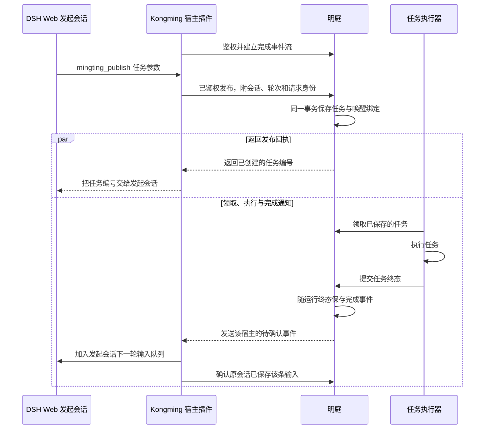

# DSH 发布明庭任务后唤醒原会话 · 技术设计

> 功能依据：[spec.md](spec.md) · 本轮用户确认的自动绑定、审批独立及双会话交错验收。  
> 设计状态：已确认 · v1。用户在核对严格事件 ID 去重和发布回执并行时序后，要求继续执行 req 和指定的 x-dev。  
> 变更范围：明庭接收经认证的 DSH 宿主发布与事件回执，孔明 Web 通过 Kongming 自有插件接入。

## 需要确认的关键决策

| 决策                         | 设计与理由                                                                                                                              | 影响                                                                                               |
| ---------------------------- | --------------------------------------------------------------------------------------------------------------------------------------- | -------------------------------------------------------------------------------------------------- |
| D01 · 由宿主提供发布身份     | `mingting_publish` 只让模型填写任务字段。插件从实际执行工具的顶层 Agent 取得会话和当前轮次。明庭从认证凭据解析 `hostId`，随任务提交绑定 | 同一 Web 宿主的普通会话和固定孔明会话共用入口。部署配置只包含宿主身份与本机连接参数                |
| D02 · 由宿主常驻接收完成事件 | 通过宿主主动建立的本机鉴权事件流交付，复用明庭持久事件和 DSH 原会话队列。宿主将事件编号用作消息请求身份，确认保存后回执                 | 孔明 Web 需要启用新插件。现有单会话启动日志取证路径在切换后移除，既有 Codex 唤醒和历史记录继续可读 |
| D03 · 完成唤醒与审批分离     | 新发布入口本轮使用网页审批。明庭为宿主绑定的任务生成完成事件，网页审批沿用现有行为                                                      | 旧发布和审批订阅入口维持原有契约。DSH 宿主收到的是完成通知                                         |
| D04 · 保留单任务串行执行     | 两条任务先进入队列并结束发起轮次。先接入 B 的执行器，核对两会话后再接入 A 的执行器                                                      | 两条任务可以反序完成，无需修改领取规则或暂停现有服务                                               |

## 整体结构与数据归属

任务和唤醒绑定提交后，发布回执与执行流程各自推进。完成事件提前到达时，宿主将它排入原会话的下一轮。

| 数据                 | 权威来源                             | 读写边界                                                                 |
| -------------------- | ------------------------------------ | ------------------------------------------------------------------------ |
| 宿主身份和权限       | 明庭配置中的稳定 `hostId` 与凭据映射 | 宿主在本机连接中证明身份。明庭由认证结果确定发布、收取和确认的归属       |
| 发起会话与轮次       | DSH 工具运行上下文与当前会话事件     | Kongming 插件读取，明庭保存发布时的快照。显示名仅用于展示                |
| 任务绑定和完成通知   | 明庭现有任务、运行和唤醒事件存储     | 复用任务事务、运行终态及事件编号。同一宿主、同一发布请求返回同一任务编号 |
| 已收取消息和唤醒轮次 | 原 DSH 会话输入队列与会话记录        | Kongming 插件提交和确认，验收从会话记录核对实际新轮次                    |

## 会话身份与发布

Kongming 自有插件使用 `defineTool` 注册工具，采用现有 `kmh-team` 工具读取 `exec.agent` 的模式。要求当前 Agent 属于该 Web 宿主的顶层会话，并能从当前会话记录确认尚未结束的发起轮次。会话身份取 `exec.agent.id`，发起轮次取 DSH 原生轮次编号，发布请求身份由会话、轮次和 `exec.callId` 派生。身份或轮次缺失时工具返回明确错误。

明庭的宿主发布入口只在宿主通过鉴权且事件流已就绪时接受新发布。它在原任务事务内保存发布请求身份与任务编号的对应关系。相同请求重试返回原任务编号，内容变化时拒绝。模型参数中的会话身份字段会被拒绝，明庭以认证身份和宿主提交的实际会话上下文为准。

本轮通过 Kongming 自有 package 和 Web profile 接入，依赖 DSH 的公开工具、会话控制和持久化能力。DSH 子模块保持上游版本管理。

## 事件投递与去重

明庭继续在运行终态事务内创建完成事件。宿主事件流只发送该身份的待确认事件。同一事件在一次连接中只发送一遍，重连时可补发仍待确认的事件。确认丢失时宿主重试原确认；断开后的新连接可重新读取同一个事件编号。

插件依事件中的会话身份调用当前 Web 宿主的 `sessionController.prompt`，使用 `queue` 模式和稳定 `requestId = eventId`。DSH 已按请求身份在当前队列和历史消息中去重。宿主确认输入已进入持久队列或会话历史后向明庭确认。回执只表示宿主接收，真实验收还要看到独立的 `turn/start`。目标会话归档或不可用时，保留该任务对应的失败信息和原目标。

现有唤醒投递器按绑定种类处理旧记录。宿主事件流只处理新绑定。切换完成后移除固定孔明会话编号和从启动日志读取授权的配置。历史绑定继续查询，保留 Codex 现有入口和按聊天限定的规则。

## 验收顺序

先预检两个有独立身份、能正常完成文本任务的真实执行器。使用隔离的明庭任务存储控制接入时机，孔明 Web 仍使用现有原会话。A、B 分别由原孔明和新 DSH Web 会话通过工具发布，指定不同且暂未接入测试实例的执行器。两个发起轮次结束后接入 B 的执行器。B 完成后先检查新会话已开启一轮，原孔明没有 B 的事件，A 仍在排队。再让 A 的执行器上线，检查原孔明开启一轮且新会话没有 A 的事件。保留双方真实日志，再启用正式本机配置并验证两个发布入口处于就绪状态。

## 验证状态与交接

已核对单执行槽、定向离线队列、持久完成事件，以及 DSH 按消息请求身份检查现有队列和历史记录的代码。上一轮单会话实测已验证宿主队列能唤醒原聊天。本次双会话发布、重连去重、网页审批组合仍待实现与验证。

## 附录 A · 协议与配置

新契约以明庭 `src/shared/task-wakeup.ts` 和现有发布字段 schema 为权威，拟为宿主入口导出可校验的版本化契约。Kongming 从该定义生成消费侧的校验和类型，自动检查生成物与源契约一致。现有 UUID 回合字段及 Codex 契约保留。DSH 的轮次使用大于零的整数。

| 接口或记录                  | 契约草案                                                                                                                                                 |
| --------------------------- | -------------------------------------------------------------------------------------------------------------------------------------------------------- |
| `POST /wakeup-host/publish` | 鉴权宿主提交标题、描述、执行目标、`sessionId`、`originTurn`、`publishRequestId`。明庭写入认证所得 `hostId`，返回任务编号。重试返回相同编号               |
| 持久绑定                    | 区分旧聊天绑定和 DSH 宿主绑定。宿主绑定保存 `hostId`、`sessionId`、`originTurn`。发布请求身份在同一宿主内唯一                                            |
| `GET /wakeup-host/events`   | 经本机 Host 和 Bearer 校验，建立完成事件流。包含 `eventId`、`taskId`、`runId`、目标会话、发起轮次和完成时间                                              |
| `POST /wakeup-host/ack`     | 同一宿主提交事件编号和原会话身份，服务逐项匹配持久目标。成功确认可重复。投递失败按现有事件诊断方式保留                                                   |
| 部署配置                    | 宿主编号与专用凭据通过本地受限配置提供，宿主和明庭各自读取。目标会话从每次真实调用取得。事件流复用明庭的心跳间隔，重连间隔与请求超时在宿主插件中具名维护 |

## 附录 B · 验证用例

| 用例                        | 来源及目的                                                                           | 流程与观察点                                                                                                                                                               |
| --------------------------- | ------------------------------------------------------------------------------------ | -------------------------------------------------------------------------------------------------------------------------------------------------------------------------- |
| T1 · 双会话真实逆序完成     | feat01 场景1、feat02 场景1。C1–C3、D01–D04。发现固定目标、按发布顺序配对或跨会话误投 | 按验收顺序真实运行。收集两个会话的发起回合、任务编号、明庭完成事件及原会话的新轮次。同一事件只在正确会话出现一次，B 完成时 A 仍排队。测试实例退出后保留真实会话记录        |
| T2 · 缺失或伪造发起身份     | feat01 场景2。C1、D01。发现错误接受任意目标                                          | 在隔离实例向工具传入额外的接收会话字段，并分别以无 Agent、无发起轮次、无宿主连接或错误凭据调用。断言明确失败、任务数不增加、两会话轮次不变                                 |
| T3 · 重送同一完成通知       | feat02 场景2。C2、D02。发现确认丢失后重复唤醒                                        | 在宿主已保存输入而确认未送达时断开事件流，重连补发。同一个 `eventId` 最终确认成功，原会话只保存一次对应输入并启动一次回合。分别检查消息已排队和已进入历史的情况            |
| T4 · 网页审批后仍能完成唤醒 | feat02 场景3。C3、D03。发现网页审批与唤醒仍被旧规则绑定                              | 在隔离明庭使用既有可控执行器触发实际审批流程，从网页执行一次同意，再结束任务。核对审批决定、完成事件和发起会话独立新轮次。替身只承担执行器报送，审批与投递路径使用真实实现 |
| T5 · 新旧投递并存的读取边界 | D02、D03 与现有兼容约定。发现历史解析或原审批链路回归                                | 以旧绑定、带发起方审批的旧任务和无绑定任务运行现有唤醒回归，核对宿主流只读取自有的新绑定。用同一新发布请求重发两次，检查只返回一个任务编号                                 |

用例当前均为待执行。T1 是真实双会话交付门槛。T2–T5 补验故障和兼容性。实际结果集中记录在后续统一测试报告。

## 附录 C · 依据与规范

- 功能基线为同目录 `spec.md`，SHA-256 为 `6fff53fad14c1224e19ac36ccdca1e181c3a73284fabc83629a32e9129029c27`。确认来源是用户本轮「按这个方案实现」及其指定的两个实际会话、自动绑定和交错完成。
- 技术基线为上轮修正并行时序后的草案，SHA-256 为 `3fc2a3f00a1f690cbfdca5f72f9964ff1d10e8c3e0f2a657789d4cfd62503e04`。确认依据是本轮用户明确要求继续 req 和 x-dev。
- 明庭现有依据包括 `src/server/service.ts` 的 `publish`、`claim`，`src/server/store.ts` 的 `publish`、`saveRun` 和 `enqueueWakeup`，以及 `src/server/kongming-wakeup.ts` 的单会话验证。
- DSH 依据包括 `packages/kmh-team/src/roles/tool.ts` 的 `exec.agent` 用法，以及上游 `packages/api/session-controller/src/commands.ts` 的 `prompt` 和 `hasPromptRequest`。Kongming 的子模块修改边界及浏览器验收以其仓库 `AGENTS.md` 为准。

| 规则                    | 落实与检查                                                                                  |
| ----------------------- | ------------------------------------------------------------------------------------------- |
| R1 模块边界             | 适用。平台管理任务和事件，插件管理会话。审查导入方向及 DSH 公开接口使用                     |
| R2 协议优先             | 适用。明庭 schema 是边界权威，校验两端请求和响应。T2、T5 验证                               |
| R3 跨语言协议           | 不适用。本轮两端均为 TypeScript，仍检查消费侧生成契约一致性                                 |
| R4 数据唯一来源         | 适用。绑定和投递记录以明庭为准，新轮次以 DSH 日志为准。T1 对账                              |
| R5 概念命名             | 适用。新契约统一用 `hostId`、`sessionId`、`originTurn`，旧 `threadId` 限于兼容路径。T5 核对 |
| R6 具名配置             | 适用。宿主编号和凭据显式配置，心跳、超时及重连参数有单一定义。检查配置和断开路径            |
| R7 数据流与状态         | 适用。核对发布、终态、回执三个提交边界。T1、T3、T5 核验交错、重放和幂等                     |
| Kongming 插件及验收规范 | 适用。自有插件和 Web profile 承接，复用上游服务。两端类型检查与测试后执行 T1 真实浏览器验收 |
