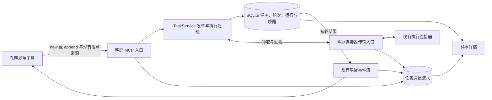

# 同一任务的多轮沟通与通信计数 · 技术设计

> 功能依据　[已确认的 spec](spec.md)，基线见[附录 C](#baseline)。
>
> 设计状态　用户已确认 · 2026-11-07 v0.1。
>
> 变更范围　明庭的发单、执行领取、结果回传、通信记录和任务详情，以及孔明发单工具与唤醒消息。

## 关键决策

| 事项 | 设计 | 影响 |
| --- | --- | --- |
| [一张单与多轮执行](#turns) | 沿用 `taskId` 和既有发单工具。`new` 创建任务及第 1 轮，`append` 将一轮新指令挂到原单。按轮保存来源、执行和结果。 | 上一轮结束且运行释放后可追加。追加适用于上线后已记录首轮的新单。列表状态反映最新一轮的执行，发布者决定后续。 |
| [通信如何计数](#sequence) | 明庭为每张单维护一条通信记录。`seq` 在明庭收发消息时分配，跨轮持续递增。 | 记录实际收发，重送也按真实通信计数。连接器的回传序号、事件标识和送达确认各自沿用现有用途。 |
| [发布和结果如何传递](#publisher) | 现有工具增加 `new`、`append` 两种入参。追加只传原 `taskId` 和本轮内容。通过现有结果和唤醒通道带回任务轮次。 | 旧发单参数继续按新建处理。跨仓变更集中在明庭协议和孔明自有插件，现有回执及兼容规则见[附录 A](#contract)。 |

<a id="ownership"></a>

## 整体结构与数据归属



图中连接器的消息经过明庭传输入口，流水的唯一写入者是明庭。代码依赖为 `transport → TaskService → Store`，客户端与服务端共用协议定义。

| 数据 | 权威来源及写入方 | 读取与派生 |
| --- | --- | --- |
| 任务身份、标题、发布者名称、执行及审批设置 | `tasks`，由现有新建流程写入。任务 ID 和链接贯穿各轮 | 列表按任务读取一条记录。现有状态和当前运行指针表示最新轮的执行投影 |
| 轮次内容、状态、来源和唤醒绑定 | 新表 `task_turns`，`TaskService` 通过 `Store` 写入。主键为 `(task_id, task_turn)` | 领取按对应轮读取指令。详情按轮展示，通知按运行关联的轮查目标 |
| 执行、审批与结果 | 现有 `runs`、审批记录及结果事件，运行新增 `taskTurn` 关联 | `runId` 标识一次执行。既有重试产生新的运行，同属原轮 |
| 通信记录 | 新表 `task_communications`，明庭通过 `Store` 追加。主键为 `(task_id, seq)` | 详情按 `seq` 升序查看。最新序号即累计条数，按任务的流水推导 |

<a id="turns"></a>

## 任务轮次如何创建和执行

任务清单的「状态」和「轮次」分别使用现有状态与最新 `taskTurn`。`succeeded`、`failed` 显示「共 N 轮」，其他状态显示「第 N 轮」。历史单缺少轮次记录时显示「—」。详情使用同一展示规则。

`new` 分配新 `taskId`，在现有发布事务内保存第 1 轮、首条通信和领取事件。`append` 通过现有已认证的 KMH 来源验证原发布者，在同一事务内读取该单最大轮次，分配 `taskTurn = 最大轮次 + 1`，保存本轮内容、实际来源、唤醒绑定、首条本轮通信和领取事件。`taskTurn` 是明庭分配的正整数，作用域为一张单。两个任务可以同时各有第 1 轮。

追加复用当前串行执行约定。最新轮处于终态且原运行已释放时才受理下一轮，排队、执行、等待审批或清理中的轮次复用忙碌错误。追加成功时，将现有任务的最新执行状态置为 `queued` 并清空 `currentRunId`。轮次状态复用既有执行状态。更新轮次状态时，在同一事务更新任务行的最新轮状态投影，供现有队列和列表使用。领取前取消的轮也保有状态。任务标题和执行设置取首次发布，各轮内容和结果保留在对应轮。运行结束产生本轮结果，发布者收到后可以继续追加。例如第 3 轮交付「最终计划」，发布者再追加就得到第 4 轮。明庭按轮执行和回传，任务是否结束由发布者判断。

领取事件记录对应轮。连接器沿用已有的领取请求，把 `task.available.id` 随请求传作 `deliveryId`。明庭用它校验领取事件的任务和轮次，当前轮领取成功后在运行记录中固定 `taskTurn`，并把本轮指令放入现有领取回执的 `task.description`。旧轮领取事件到达时返回现有连接器会丢弃的 `410`。连接器按领取事件标识保留待领取项，避免旧轮事件占住新轮。报告、审批、取消和唤醒都通过 `runId` 回到原轮，更新最新轮投影时核对当前运行。现有重试仍属同一轮，`LIMITS.runsPerTask` 在多轮任务中按当前轮的运行次数使用。

<a id="sequence"></a>

## 通信序号的计数边界

`seq` 是**同一任务在明庭的消息收发流水号**。首次受理的 `new` 记录为 `1`，后续每条实际收发加 `1`。它在一张单内跨 `taskTurn` 累计，只服务于排序和统计。它保存在明庭流水及其查询结果中。连接器已有 `report.seq` 是单次运行的回传顺序，`run_audit.seq` 是单次运行的审计顺序，两者沿用原协议。

| 实际经过明庭的消息 | 计数与轮次归属 |
| --- | --- |
| 发布者发 `new` 或 `append`，明庭回发单回执 | 请求、回应各一条。成功请求和回应都归到此次分配的任务轮次。 |
| 明庭向连接器写 `task.available`，执行者发 `claim`，明庭回领取结果 | 每个实际送出的事件帧一条，领取请求和回应各一条。轮次取领取事件记录。排队动作本身属于内部状态变更。 |
| 执行者回报会话、设置、进度、结束，或发该运行的心跳和审批请求，明庭回应 | 每个请求和每个回应分别计数，轮次取 `runId` 的固定关联。审批结果查询也按实际请求与回应计数。 |
| 明庭向结果订阅者写本任务的状态或结果，向孔明写带结果的唤醒事件 | 每个实际写出的任务消息一条，按运行关联或状态消息所指的轮次记账。结果随唤醒同帧发出时计一条。结果订阅与唤醒实际发成两条时各计一条。任务级订阅请求归属订阅时的最新轮。 |
| 孔明确认接收唤醒，明庭回应确认 | 确认请求和回应各一条，轮次取已登记事件。宿主发给自身会话的内部入队属于宿主内部动作。 |
| 现有任务审批、取消和重试操作 | 执行任务操作的一方按发布者角色记账。请求和回应各一条，审批取对应运行的轮次，取消与重试取操作所针对的最新轮。 |
| 重复接收、事件流重放及已授权任务的操作失败 | 已实际收发且可归属的消息照常计数。原业务动作继续使用现有请求号、回传序号或事件号判断是否已经处理。已识别任务的忙碌回复归到该次请求所指轮次，失败追加归到当时最新轮。 |

计数从通过现有权限校验且能关联到任务的应用消息开始。连接级 SSE `ready`、保活注释、连接器能力上报、内部队列动作，以及网页查看列表和流水，属于连接管理或观察流程。任务专属的运行心跳属于表中的执行通信。通过已有 Codex 聊天宿主唤醒时，按 `WakeupDispatcher` 调用投递的任务消息和实际返回的接收回执记账，底层 ACP 初始化与会话加载属于连接管理。

收到消息时记一条，发出时以明庭向有效的传输流程提交完整应用消息为记账点。HTTP 在 `res.json` 写出入口记账，SSE 在每个实际 `res.write` 事件帧的写出入口记账，MCP 在工具回执交给 SDK 时记账。同一 MCP 回复中的 `content` 和 `structuredContent` 同属一条。写出过程中连接中断时，已提交写出的消息计入流水，接收方是否收到以现有确认记录为准。`seq` 表达明庭处理顺序，异步发送方的网络时间和任务轮次都可能交错。

新建和追加成功时，首条入站记录随业务事务提交。其他入站消息在完成归属校验后、引发业务出站通知前记账。业务拒绝但来源和任务已确认时，处理错误的入口记录该请求及其实际回应。复用 SQLite 写事务，按 `(task_id, seq)` 查末条并追加下一号，避免并发重复和间隙。事务回滚时该事务分配的序号一起回滚。流水独立写入时直接走存储事务，使用静默提交，避免仅记录一次发包又触发一次结果广播。流水写入失败沿用现有错误与连接关闭路径。

<a id="publisher"></a>

## 发单说明、来源与唤醒

同一段指引写入明庭 MCP `mcp-mingting-tool` 的 `description`，也写入孔明实际向模型暴露的 `mingting-tools` 描述。两处都直接说明 `append` 的用法。

```text
同一任务的后续沟通使用 append，填写该任务已有的 taskId 和本轮要执行的内容。独立的新任务使用 new。后续追加沿用原任务编号。收到本轮结果后，由发布者决定是否继续追加。
```

孔明工具继续提示「发单回执和结果通知都会给出任务编号。取得回执后结束当前发单轮次，等待本轮结果通知」。通用 MCP 工具沿用原结果订阅和审批说明。

孔明从实际发单会话读取来源。明庭保存认证宿主的 `hostId`、本次实际 `publisherSessionId` 和该会话的 `originTurn`。`originTurn` 用于追溯发布者对话。唤醒路由使用本轮登记的目标会话 ID，默认为发布者会话，显式目标沿用已有授权配置。发布会话和目标会话分别保存。追加权限以首次发布的宿主和发布者会话为准。

执行结果沿用现有按运行生成的 `task.completed` 事件和确认流程。增加 `taskTurn` 的宿主帧由更新后的孔明解释成「明庭任务第 N 轮执行结束」，消息包含原 `taskId`、`taskTurn`、`runId` 和本轮结果。继续使用 `eventId` 入队及确认。发布者在该轮使用 `append` 时，从回执或这条通知取 `taskId`，发单仍只需一次工具调用。

<a id="example"></a>

## 杭州出行三轮推演

原任务记录中的孔明发起轮次为 `4、5、6`，对应信息采集、行程方案生成、冲突核对与最终计划。下面用 `T` 表示同一个任务，用 `S` 表示同一个实际发布会话。每轮记录相同的来源宿主和 `publisherSessionId=S`，其 `originTurn` 取本次对话轮次。

这张表复用对话中的 15 条简化主链路。它假设每轮只发生表列的五条通信，且发单回执先于派发。实际验收取明庭真实收发顺序，以通信流水末号核对总数。

| `seq` | `taskTurn` | 方向 | 内容 |
| ---: | ---: | --- | --- |
| 1 | 1 | 发布者 → 明庭 | `new` 杭州周末出行规划，信息采集，`originTurn=4` |
| 2 | 1 | 明庭 → 发布者 | 发单回执 `T/1` |
| 3 | 1 | 明庭 → 执行者 | 派发 `T/1` 信息采集 |
| 4 | 1 | 执行者 → 明庭 | 回传天气与出行信息 |
| 5 | 1 | 明庭 → 发布者 | 携带第 1 轮结果唤醒会话 `S` |
| 6 | 2 | 发布者 → 明庭 | `append T`，生成行程方案，`originTurn=5` |
| 7 | 2 | 明庭 → 发布者 | 追加回执 `T/2` |
| 8 | 2 | 明庭 → 执行者 | 派发 `T/2` 行程方案生成 |
| 9 | 2 | 执行者 → 明庭 | 回传行程草案 |
| 10 | 2 | 明庭 → 发布者 | 携带第 2 轮结果唤醒会话 `S` |
| 11 | 3 | 发布者 → 明庭 | `append T`，核对冲突与生成最终计划，`originTurn=6` |
| 12 | 3 | 明庭 → 发布者 | 追加回执 `T/3` |
| 13 | 3 | 明庭 → 执行者 | 派发 `T/3` 冲突核对 |
| 14 | 3 | 执行者 → 明庭 | 回传整理好的计划 |
| 15 | 3 | 明庭 → 发布者 | 携带第 3 轮结果唤醒会话 `S` |

在这个简化输入里，结果是一张任务单、三轮、15 条通信。若只为第 1 轮加入现有的领取请求和回应、执行结束的 HTTP 回应、唤醒确认请求和回应，共多 5 条，第二次发单将是 `seq=11`，三轮总数为 20。真实执行还可能产生运行心跳、过程回报、结果订阅等消息，逐条按[计数表](#sequence)累计。发布者决定继续时，`append T` 进入第 4 轮，通信序号接着原单末号加 1。对应[用例 T1](#t1)、[用例 T2](#t2)和[用例 T3](#t3)。

## 验证状态与交接

已读明庭的发单、领取、回报、存储、结果订阅与详情，以及孔明工具和唤醒实现。只读核对了杭州样例的旧任务记录，三次实际发起轮次为 `4、5、6`，旧链路三条唤醒均已送达。本轮设计推演对应新的预期数据，实际运行验证由[附录 B](#verification)安排。确认对象为开头的设计选择及下列接口、权限、计数边界和兼容规则。

<a id="contract"></a>

## 附录 A　协议与存储定义

下表为计划接口。明庭协议在 `src/shared/protocol.ts` 和 `src/shared/dsh-wakeup.ts` 中由 Zod 定义并推导类型。孔明用 `scripts/sync-dsh-wakeup-contract.mjs` 同步后者，生成文件 `packages/kmh-kongming/src/mingting-contract.ts`。

| 接口或事件 | 输入、校验与输出 |
| --- | --- |
| 现有 `/mcp` 的 `mcp-mingting-tool` 与孔明 `mingting-tools` | `new` 复用既有发布字段，`action` 可省略并按 `new` 处理。`append` 参数为 `{action: "append", taskId, description}`，其中 `taskId` 是现有任务 UUID，`description` 复用原发布正文的校验。参数保持严格校验，发单来源沿用已认证的 `publisher-context`，轮次由明庭分配。 |
| 发单回执 | 通用 MCP 和明庭网页的 `new` 原回执增加 `taskTurn: 1`，原任务链接和订阅凭据照常返回。旧 `/wakeup-host/publish` 的回执沿用 `{taskId}`。`append` 返回 `{taskId, taskUrl, taskTurn}`，继续用 `new` 发出的任务级订阅凭据。宿主按操作解析两类回执，原有结果订阅回执按任务保存。 |
| 追加校验 | 复用既有 KMH 认证和发布请求号。`append` 校验任务存在、本任务有完整首轮记录、原发布者宿主与会话匹配、最新轮已释放及现有队列容量。未知任务 `404`，身份不匹配 `403`，已识别任务的轮次忙碌或历史单追加 `409`，队列满沿用 `429`。MCP 使用既有工具错误封装。 |
| 发布请求关联 | `dsh_publish_requests` 为新记录保存分配到的 `taskTurn`。同一已有请求号和相同内容复用原回执和原轮；内容不匹配沿用现有冲突处理。原 `new` 发布请求继续匹配现有规范化指纹。这里沿用现有内部请求号，模型入参只包含上面的业务字段。重复请求实际收发各自记账。 |
| 领取、回报与确认 | `task.available` 沿用帧格式及既有全局 `id`。`POST /connector/claim` 增加可选正整数 `deliveryId`，更新后的连接器从事件自动带入。服务端核对该 ID 的任务、轮次，回执的 `run` 增加 `taskTurn`。已有连接器省略时能领取历史任务和首轮，追加轮需要带入事件标识。回报和确认继续按现有运行或事件 ID 提交。 |
| 唤醒与结果 | `GET /wakeup-host/events` 复用现有 `x-mingting-wakeup-result` 标头。`1` 继续得到当前结果帧，更新后的孔明发送 `2` 得到结果以及已登记的 `taskTurn`，服务端先支持两种值。历史结果可以省略该字段。`POST /wakeup-host/ack` 与 `/subscriber/events` 的原事件标识和订阅回执形状沿用，任务详情按 `runId` 关联每轮结果。 |
| 任务详情 | 复用 `GET /api/tasks/:id` 和网页详情。多轮记录返回 `turns`，按 `taskTurn` 升序，并从 `runs` 关联各轮输出。流水返回 `communications: {entries, lastSeq, nextSeqAfter}`，查询参数 `seqAfter` 为非负整数，默认 `0`。按 `seq > seqAfter` 升序取至多 `LIMITS.list` 条。有下一页时 `nextSeqAfter` 为本页末条序号，末页为 `null`。`lastSeq` 是整单末号。现有网页快照投影轮次和计数摘要，详情通过同一查询入口翻页。历史单沿用原详情结构。 |

| 结构 | 关键字段与约束 |
| --- | --- |
| `task_turns` | `taskId` 对应任务 UUID，`taskTurn` 正整数，从 1 开始。保存本轮 `description`、`status`、创建时间、实际 `source` 和有效 `wakeupTarget`。状态使用 `taskStatusSchema`。`source` 包含已认证宿主的 `hostId`、1–255 字符原生 `publisherSessionId` 和正整数 `originTurn`。具备 KMH 发单来源的轮必填 `source`，无宿主来源的轮为 `null`。`wakeupTarget` 沿用现有两种目标 schema，无绑定时为 `null`。唤醒按运行所在轮的 `wakeupTarget` 路由，旧任务读取 `task_wakeup_targets`。 |
| 运行、派发及发单请求关联 | `runs.data` 增加可选 `taskTurn`。`deliveries` 与 `dsh_publish_requests` 添加可空 `task_turn`，迁移用可重复执行的加列，历史记录继续走原读取路径。现有按 `runId` 保存的结果和唤醒事件保留原轮归属。 |
| `task_communications` | `(task_id, seq)` 唯一，`seq`、`taskTurn` 为正整数。每行保存 `from`、`to`（`publisher`、`mingting`、`executor` 之一）、消息类型、明庭记录时间和内容。内容记录可读业务字段或同一条消息的稳定内容引用。认证头、订阅凭据和其他私密传输字段在记录前排除，详情沿用现有权限。 |

杭州规划的两种 MCP 入参示意如下。第二条中的 UUID 来自第一次发单回执。

```json
{"action":"new","title":"杭州周末出行规划","description":"信息采集，整理天气与出行信息","publisherName":"Kongming","targetHarness":"Codex"}
```

```json
{"action":"append","taskId":"11111111-1111-4111-8111-111111111111","description":"基于第 1 轮结果生成行程方案"}
```

升级后的新建统一写第 1 轮和 `seq=1`，包括现有只传原参数的发单入口。历史任务及运行沿用原读取和通知逻辑。历史记录缺少首发通信，追加范围以本设计上线后已经记录首轮的任务为准。两套协议并存期间，先更新明庭，再更新连接器和孔明插件，历史协议仍可发单和执行第 1 轮。孔明侧改动位于自有 `kmh-kongming` 插件，使用现有公开会话控制器。

<a id="verification"></a>

## 附录 B　测试用例与覆盖

测试使用独立 SQLite、测试工作目录和测试会话。接口用例复用 `tests/platform.test.ts` 与 `tests/dsh-wakeup.test.ts` 的真实 HTTP、事件流及 SQLite 夹具。测试替身可以产生可控的执行结果和来源消息，领取、存储、通信记录和通知流程使用真实实现。结束后关闭测试连接和进程，清理隔离目录。实测证据按[统一报告约定](/Volumes/machub_app/proj/skill-hub/x-dev/references/test-reporting.md)记录，接口测试与真实网页验收分别报告。

<a id="t1"></a>

### T1　真实网页走通杭州规划三轮

- 依据与目的　feat01 场景1、2，C1、C4，D01、D03。核对宿主真实发单、执行、结果和续轮是否串到其他任务或会话。
- 准备与操作　通过孔明实际网页入口打开原会话或按网页默认流程创建测试会话，用[杭州三轮输入](#example)发起规划。首轮发单后结束发起轮次，每次收到本轮结果再向同一张单追加。测试者通过界面输入任务内容，读取系统产生的身份和编号作核对。
- 观察与证据　记录三个回执同一 `taskId`、轮次 `1、2、3`。详情、领取回执和运行记录逐轮匹配执行指令及实际结果。核对列表始终一条、每条对应唤醒只进入绑定会话一次并开启一轮、其他会话零次。保留界面证据与只读记录，标注真实 `originTurn`，以实际会话轮次为准。任务涉及文件时检查真实交付物。待实现后运行。

<a id="t2"></a>

### T2　发布者收到最终计划后继续追加

- 依据与目的　feat01 场景3，C2，D01。排查把完成状态或标题中的「最终」当作整单收尾的实现错误。
- 准备与操作　使用 [T1](#t1) 的三轮记录或同源接口夹具，第三轮内容为「冲突核对与最终计划」。执行结束并回传结果后，从原发布者发 `append`，描述为「补上地铁换乘备注」。
- 观察与证据　回执返回原 `taskId` 和 `taskTurn=4`。连接器领取第 4 轮并得到新指令，原三轮内容与结果仍可查。证据取发单回执、领取消息和详情。待实现后运行。

<a id="t3"></a>

### T3　逐条计数并核对每轮来源

- 依据与目的　feat02 场景1、2，C3、C4，D02、D03。检查回执、唤醒、确认漏记，跨轮重置，以及把发布者对话轮次当作任务轮次。
- 准备与操作　以[杭州推演](#example)为数据，使用已认证宿主夹具给出同一来源 `S`、`originTurn=4、5、6`，在临时库通过现有接口真实发单、领取、回报、订阅结果和确认唤醒。在明庭收发边界采集顺序，客户端捕获实际消息和回执，按[计数表](#sequence)分类。读取详情翻页，再核对 SQLite 中对应任务的流水和轮次记录。
- 观察与证据　首发 `seq=1`，所有实际任务通信与日志按方向、类型、内容和顺序一一对应，末号等于行数。第 2、3 轮接着前一条递增。核对任务轮次 `1、2、3`，来源宿主、会话 `S` 及实际发起轮次 `4、5、6`。结果与唤醒合帧的路径计一条，同时打开独立结果订阅时按两次真实发送计数。读详情前后计数一致。记录通信和数据库对照表。该接口夹具验证编号与归属，真实宿主自动生成身份由 T1 验收。待实现后运行。

<a id="t4"></a>

### T4　两个可见发单说明都提示追加

- 依据与目的　feat01 场景4，C5，D03。孔明模型实际看到宿主工具，需要同时核对 MCP 和宿主说明。
- 准备与操作　读取 MCP `tools/list` 返回的 `mcp-mingting-tool.description`，并在孔明插件测试中读取实际注册的 `mingting-tools` 描述和参数。采用[发单说明](#publisher)作为预期。
- 观察与证据　两处均明确表达同一任务选 `append` 并提供已有 `taskId`，独立任务选 `new`。记录工具清单与注册描述。待实现后运行。

<a id="t5"></a>

### T5　已有协议、重复消息与轮次归属

- 依据与目的　D01–D03，R2、R4、R7。检查接入多轮后，旧客户端、旧任务、实际重送及迟到领取仍能按原业务语义处理。
- 准备与操作　在隔离库使用上线前的任务、运行与结果订阅记录。用原工具参数和旧宿主标头发单，验证旧连接器领取首轮。更新的调用路径中，在上一轮已结束时追加一次，延后连接器领取，分别重送同一请求和发不同请求，观察忙碌状态。将第 1 轮的领取事件及唤醒事件交给连接器和宿主再次处理。使用另一个会话尝试追加。对流水插入事务注入回滚。
- 观察与证据　历史结果照常读取和投递，旧协议能创建并执行首轮。同请求实际收发计数递增，业务仍只有一个新增轮。不同请求在最新轮忙碌时得到原错误语义。迟到领取得到 `410`，当前轮可被自己的事件领取。宿主按原 `eventId` 只保存一次唤醒输入，重复收发有独立 `seq`。其他会话得到权限错误。事务回滚后序号连续，领取、唤醒和历史记录归属正确。证据为 HTTP 帧、隔离库记录与宿主测试记录。待实现后运行。

| 需求场景 | 用例及观察点 | 执行状态 |
| --- | --- | --- |
| feat01 场景1 | [T1](#t1) 首次回执、首轮领取与一条任务记录 | 待实现 |
| feat01 场景2 | [T1](#t1) 两次追加回执、三轮结果与三次对应唤醒 | 待实现 |
| feat01 场景3 | [T2](#t2) 原任务第 4 轮的回执和执行 | 待实现 |
| feat01 场景4 | [T4](#t4) 实际暴露的两处工具描述 | 待实现 |
| feat02 场景1 | [T3](#t3) 真实收发、逐行计数与跨轮总数 | 待实现 |
| feat02 场景2 | [T3](#t3) 逐轮来源记录，[T1](#t1) 实际网页身份核对 | 待实现 |

<a id="baseline"></a>

## 附录 C　调查、基线与追溯

- 首次确认的 spec 基线 SHA-256 为 `fdb8c9c9bc8d2e568d4564a48969c694ec42900022b32ab4f580c218c04f61b0`。2026-11-07 用户在本聊天明确回复「确认，继续走 x-tech-design」，授权按该版 spec 设计，并要求保留推演数据、计数规则和追加提示词。
- 设计 v0.1 由用户在 2026-11-07 本聊天确认，原确认稿 SHA-256 `816765435dca61a62b28e07fcb4afddbfc0fd8cd9643f724ede1046bcf408f83`。用户授权按该版 spec 与设计通过明庭 MCP 定向交给 Codex，要求附两份文档路径和杭州三轮验收，按剃刀法则保持范围。既有链路参考[统一发布技术设计](../unified-task-publishing/tech-design.md)和[仓库验收约定](../../../AGENTS.md)。执行涉及明庭与孔明自有插件两仓。
- 用户在 2026-11-07 本聊天进一步明确任务清单的状态与轮次分栏。该展示补充见 [轮次机制](#turns)和当前 [spec](spec.md) 的 feat01。当前 spec SHA-256 为 `16ca744f98a08d7ae61ae13ff17ffb7369528d924ea9b27bb41842d196cc7b97`。

| 当前代码证据 | 已核对事实与本次影响 |
| --- | --- |
| [发单和执行服务](../../../src/server/tasks/service.ts)、[SQLite 存储](../../../src/server/storage/store.ts) | `publish` 每次创建任务。`claim`、`report` 与 `retry` 围绕任务及当前运行处理。原 DSH 请求表已有请求关联，现有唤醒目标按任务保存。本设计增加按轮快照和消息流水。 |
| [HTTP 与 MCP](../../../src/server/transport/http.ts)、[连接器](../../../src/connector/connector.ts) | 领取事件有全局 `id`，回报有每次运行自己的 `seq`。任务级收发记账放在已有传输入口，领取复用 `id` 关联轮次。 |
| [宿主传输](../../../src/server/transport/dsh-wakeup.ts)、[明庭权威契约](../../../src/shared/dsh-wakeup.ts)、[孔明插件](../../../../kongming-os/packages/kmh-kongming/src/mingting.ts) | 当前宿主按会话 ID 入队、按事件 ID 确认，明庭帧使用严格 schema。沿用唤醒通道，通过现有标头选择带轮次的帧。本轮末次只读同步检查发现当前工作区的生成文件与权威源有差异，交付时以实现完成后的 `--check` 为准。 |
| [任务详情](../../../src/web/main.tsx) | 已有列表、运行选择器、结果与唤醒展示。任务轮次和流水用现有任务详情承载。 |

| 设计 | 需求依据 | 用例 |
| --- | --- | --- |
| D01 [任务轮次和执行归属](#turns) | C1、C2，feat01 场景1–3 | T1、T2、T5 |
| D02 [任务通信记账](#sequence) | C3，feat02 场景1 | T3、T5 |
| D03 [发单说明、来源与唤醒](#publisher) | C4、C5，feat01 场景1、2、4，feat02 场景2 | T1、T3、T4、T5 |

| 规范 | 适用性、落实与验证 |
| --- | --- |
| R1 模块边界 | 适用。按[数据归属](#ownership)保持传输、任务服务与存储单向依赖，落地审查导入方向和 `Store` 公开方法。 |
| R2 协议优先 | 适用。按[附录 A](#contract)以 Zod 定义边界。实施时执行 `npm run build`，用 T4、T5 检查调用参数及旧帧解析。 |
| R3 跨语言协议 | 两侧均为 TypeScript，跨语言生成不适用。同语言跨仓协议用现有同步脚本生成并通过 `--check` 核对。 |
| R4 数据唯一来源 | 适用。轮次和流水各有权威表，最新轮与末号从相应记录派生。T3、T5 核对提交、回滚及历史读取。 |
| R5 概念命名 | 适用。统一用 `taskTurn`、`originTurn`、流水 `seq`，在 T3 检查三者的归属及编号。 |
| R6 具名配置 | 适用。继续引用 `LIMITS` 的队列、运行、分页约束和现有唤醒正文配置，审查约束引用和 T5 的兼容结果。 |
| R7 数据流与状态 | 适用。按 D01–D03 核对事务、领取归属和事件交付，用 T1、T2、T5 验证。 |
| 明庭及孔明仓库规则 | 适用。T1 遵循真实网页验收约定，孔明侧遵循 [Kongming OS AGENTS.md](../../../../kongming-os/AGENTS.md)。插件运行 `pnpm --filter @kmh/kongming typecheck` 和 `pnpm --filter @kmh/kongming test`，同时执行明庭相关测试及契约同步检查。 |
