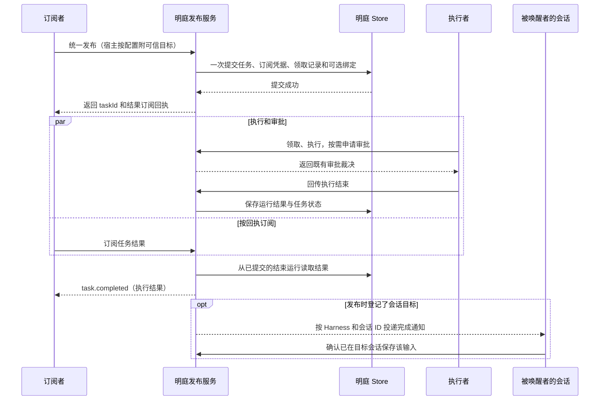

# 统一发布明庭任务和订阅结果 · 技术设计

> 功能依据为 [spec.md](spec.md)，第一阶段聚焦 KMH，见[基线](#baseline)。
> v1.4 第一阶段设计基线。实现和验收状态见[开发任务](tasks/task-kmh-mcp-publish.md)。
> 第一阶段覆盖 KMH 会话的统一发布、回执、结果订阅和唤醒。退役旧入口属于第二阶段。

## 第一阶段设计决策

| 决策 | 建议与理由 | 影响 |
| --- | --- | --- |
| D01 [统一发单和回执](#publish) | 网页与 MCP `mcp-mingting-tool` 共用 `TaskService.publish`。每条新任务都发结果订阅凭据，审批权限按原规则判定 | 新增可回滚的任务订阅记录。旧审批凭据和已发任务继续按原契约使用 |
| D02 [从已有运行结果补发](#results) | 在现有订阅接口提供结果视图，从已保存的终态运行产生完成通知。断线重连时按运行编号补收 | 每个结束运行有稳定事件编号。结果订阅与审批选择独立。网页沿用现有任务详情订阅 |
| D03 [登记被唤醒者与投递](#host) | KMH 宿主读取当前发单会话，通过标准 MCP 发单时附上可信来源和目标。复用已有注册、完成事件流、会话入队和确认。默认唤醒发单会话，显式配置可选择同一宿主中的已有会话 | 每个 KMH 宿主复用一条唤醒监听连接。结果订阅者和被唤醒者可以分别归属 |
| D04 [先并行验收](#cutover) | 保留旧发布、投递、回执和历史记录。通过真实网页验收后再切换默认入口 | 第一阶段可单独验证和回退。第二阶段由用户确认启用，退役范围为旧入口的新发单能力 |

## 整体结构与数据归属

明庭按订阅者、执行者和被唤醒者描述任务角色。现有 MCP 的 `wakeup` 按 UUID 校验，并由已配置的聊天宿主处理。KMH 网页默认会话 ID 可带 `session-` 前缀，发单轮次为整数，现有 KMH 宿主协议已经支持这两种原生值。统一链路要把 KMH 的会话绑定接到标准 MCP 发布，并补齐独立于审批的结果订阅。见[发布校验](../../../src/server/service.ts#L189)、[审批快照](../../../src/server/service.ts#L290)和[KMH 宿主协议](../../../src/shared/dsh-wakeup.ts)。

| 数据 | 权威来源 | 写入和读取 |
| --- | --- | --- |
| 任务、执行、审批 | 明庭既有 `tasks`、`runs`、`approvals` | `TaskService` 写，执行连接器、网页和订阅服务按各自权限读 |
| 新任务订阅权 | 明庭新增 `task_result_subscribers`，每任务一行，仅存凭据哈希 | 发布事务写，结果订阅查验。原 `approval_subscribers` 继续服务已有回执 |
| 唤醒目标与投递确认 | 明庭既有 `task_wakeup_targets`、`task_wakeup_events` | 可信宿主声明目标，发布事务保存。KMH 继续按同一宿主身份确认接收，网页快照显示 |
| 会话入队及新轮次 | 宿主会话输入队列与历史 | 宿主负责入队并去重。端到端验收从会话历史核对实际新轮次 |

依赖方向为 HTTP/MCP → `TaskService` → `Store`。共享协议由明庭定义并供入口和客户端消费。会话客户端依赖通用 MCP、结果订阅和自身的公开会话控制接口。

## 统一发布与订阅权限

网页和 MCP 调用同一个发布服务，沿用 `publishTaskSchema` 的任务字段和执行设置检查。网页入口使用网页会话鉴权，生成结果回执时保持聊天目标为空。会话客户端提供本次真实发单来源。明庭按发单时生效的配置登记唤醒目标，显式配置优先，默认使用发单 Harness 与当前会话。来源或目标无法验证时返回明确错误。已登记的任务按自己的绑定投递。

任务、结果订阅凭据的哈希、领取记录和可选绑定在同一个事务提交。回执统一包含 `taskId`、`taskUrl`、`resultSubscription`。选择订阅者审批时兼容返回 `approvalSubscription`，它引用同一个新任务凭据。审批意见仍检查任务启用了订阅者审批，并校验当前审批、运行和执行会话。只有网页审批的新任务同样能订阅结果，其结果凭据不能提交审批意见。网页保留原网页审批和查看结果行为，页面展示任务编号及链接，凭据留在授权回执中。

新增订阅表与旧凭据表并存。当前版本的旧表使用 `INSERT ... VALUES(?,?)`，新增列会影响旧进程写入。独立表可保留旧表结构与数据，也让已有审批凭据继续限于原有权限。新增任务的凭据由新表统一核验，历史任务仍用原来路径。

## 结果投递与断线补收

`GET /subscriber/events` 增加显式结果视图，复用当前本机鉴权、SSE 连接、心跳和连接上限。旧调用继续收到审批快照。新结果视图连接时先发送当前任务状态，然后从 `runs` 逐条发送已有结束运行。连上以后，使用事务提交后的既有变更通知读取新增结果。先登记监听再读存储，单连接按事件编号去重。写入遇到背压时暂停，等可写后继续读存储和发送。连接断开后从已有结果重新读取，消费者按编号去重。

已结束运行以 `endedAt` 为判据，`task.completed:<runId>` 作为稳定编号，携带实际终态与保存的输出。失败和中断保留真实状态。未领取即取消的任务由状态快照表达，完成事件对应真实存在的运行。任务重试沿用原任务编号，各运行保留独立结果。查询按运行分帧，单帧按现有输出限额及 JSON 编码上界设置具名上限。用已存运行补收即可，结果本身只保存一份。

推演见 [T5](#t5)。任务 `A` 的运行 `R1` 在订阅前保存了输出。订阅首次连接仍读到 `task.completed:R1`，重连时再次读取的编号保持一致。若任务先失败后重试成功，两次运行结果可以按各自的编号和状态核对。

## 被唤醒者登记、回执恢复与重复通知

KMH 宿主从本次真实工具执行的 `exec.agent` 读取顶层会话 ID 和当前发单轮次。标准 MCP `tools/call` 的私有元数据携带原生 `sessionId` 和整数 `originTurn`。明庭复用现有的 KMH 宿主凭据和注册配置认证请求，以已验证的身份确定 `hostId`。工具面向模型的业务参数沿用标准发布参数。默认使用本次实际发单的会话。试点在宿主配置按发单会话指定可选目标，由 KMH 核验同一注册宿主下的目标会话已授权且可用。发单轮次属于发单会话，配置目标 B 时也记录 A 的发单轮次。发单来源与投递目标分别保存。

KMH 的原生 MCP 转发器目前只转发工具名和业务参数。试点复用现有 `kmh-mingting` 插件，给所有 KMH 用户会话提供同一个发单动作。插件读取可信会话上下文，经 `/mcp` 调用标准 `mcp-mingting-tool`，由 `TaskService.publish` 统一保存任务、回执和可选唤醒绑定。启用插件的会话向模型暴露一个宿主发单动作 `mingting-tools`。只订阅结果的客户端可以直接调用同一个 MCP 工具。

KMH 从会话、轮次和工具调用编号计算稳定的发布请求号。明庭根据已认证的宿主凭据和请求号派生结果订阅凭据，只在数据库保存哈希，并在同一事务记录请求指纹。响应丢失时，宿主在本次调用内用同一请求重试。明庭返回原回执，内容变更时拒绝重试。KMH 私密保存正式回执后才向会话显示发布成功。宿主跨进程自动恢复尚未确认的发布请求待验证。

订阅者用任务回执接收结果。KMH 复用宿主级 `/wakeup-host/events` 监听和现有确认接口，按任务登记的目标会话调用 `sessionController.prompt`，用事件编号作为 `requestId` 入队。会话忙时等待当前轮次结束，在同一会话继续一轮。宿主确认目标会话已保存输入后回报。掉线或确认丢失后，相同编号复用已有输入。订阅结果与会话入队各有自己的接收方，只有宿主唤醒事件驱动会话输入。网页从发单时保存的目标和现有投递记录直接生成摘要，统一显示会话 ID、发单轮次和投递状态。真实唤醒以已登记会话的历史为准。

新发布沿用既有 KMH 绑定和 `task.completed:<runId>` 完成事件格式。旧入口已发布的任务与新 MCP 任务通过同一宿主事件流收尾。临时断线后从已保存的待确认事件补收。目标在发单后归档或删除时，宿主回报会话不可用，明庭保留投递失败记录，任务的结果订阅照常可用。后续 Harness 的接入单独安排。

推演见 [T6](#t6) 和 [T7](#t7)。A 和 B 沿用默认目标时，A 的任务回到 A，B 的任务回到 B。若 A 明确配置了已授权的目标 B，执行结果仍交给订阅者，唤醒消息进入 B 的已有会话。即使保存输入后丢失确认，重连复用事件编号也只产生一条输入与一次新轮次。

## 并行验收与切换边界

1. 第一阶段先在隔离实例跑通通用 MCP 与网页共用的发布和结果订阅，再从 KMH `http://127.0.0.1:60000/` 打开已有「孔明」会话和普通会话验收，另用网页「新建会话」覆盖默认生成的会话身份。试点使用单独配置选择新链路。旧入口、原任务、原运行及旧通知保持可用。
2. 验收同时放入一笔已有待完成任务和一笔已有已完成任务。验证升级后原记录可查询，原待完成任务仍可执行和投递。回退只切换后续发单，已发新任务由能读取新回执的服务处理。结果未知的发布按原请求恢复，避免再次发出同一任务。
3. 第二阶段在第一阶段通过并经用户确认后，停用旧专属入口的新发单。历史查询和已经受理任务的结果投递继续可用。第二阶段以 [T8](#t8) 单独验收。

## 验证状态与交接

已验证既有孔明和普通会话的四笔真实发单、执行结果及逐笔唤醒。另以普通会话的自然语言发单验证了默认生成的会话 ID 和实际续轮。任务详情显示同一笔已保存的绑定与投递结果。各阶段验证范围和缺口见[统一发单](tasks/task-kmh-mcp-publish.md)、[工具改名](tasks/task-rename-mcp-publish-tool.md)和[任务详情](tasks/task-kmh-wakeup-display.md)。

## 附录 A　协议、结构与配置

以下为实现契约。由 `src/shared/protocol.ts` 及其引用的共享 Zod schema 定义。试点客户端使用明庭生成的最小子集，复用 `scripts/sync-dsh-wakeup-contract.mjs` 的同步与漂移检查方式。

| 接口或结构 | 输入与约束 | 输出及失败行为 |
| --- | --- | --- |
| MCP `mcp-mingting-tool` 和网页发布 | 共用既有任务参数。MCP 的 `params._meta["mingting.local/publisher-context"]` 可携带发单会话 ID、发单轮次、稳定发布请求号和可选目标会话 ID。元数据必须经过本机宿主认证，网页发单表单不提供聊天目标 | `{taskId, taskUrl, resultSubscription, approvalSubscription?, wakeupTarget?}`，有 KMH 绑定时回显 `wakeupTarget`，旧 MCP `wakeup` 形状在兼容分支保留。错误返回明确原因 |
| `resultSubscription` | `{taskId, subscriptionToken}`，复用 UUID 和 64 位小写十六进制的现有凭据格式 | `task_result_subscribers` 以任务 ID 为主键，存储凭据哈希。宿主发布额外存规范化请求指纹。原始凭据只交给授权调用方 |
| KMH 唤醒目标 | 持久目标记录含 `hostId`、`sessionId`、`originTurn` 与发单会话 ID。`hostId` 复用已注册 KMH 宿主身份。`sessionId` 为 1–255 字符的原生会话 ID。默认取发单来源，显式指定时校验同一宿主下已授权的已有会话。发单来源单独记录会话及正整数 `originTurn` | 按现有 KMH 绑定格式存于原绑定表。网页详情投影目标和状态摘要 |
| 结果订阅 | `GET /subscriber/events?taskId=…&view=result`，`Authorization: Bearer …`。校验任务与结果凭据配对 | 首帧 `task.status` 含任务编号与当前状态，结束运行各一帧 `task.completed`，含 `eventId`、`taskId`、`runId`、`status`、`output`、`error`、`endedAt`。无效凭据拒绝，超连接上限沿用 429 |
| 宿主投递确认 | 复用 [KMH 宿主投递确认契约](../../../src/shared/dsh-wakeup.ts)。按目标宿主鉴权，携带事件编号、目标会话和接收结果，校验事件对应的已结束运行及绑定 | 首次保存投递记录。相同确认幂等，异任务或异宿主请求拒绝。旧确认字段保持兼容 |
| 凭据及限额 | 第一阶段复用当前配置中的本机宿主身份和凭据文件。连接上限、心跳、输出长度沿用 `LIMITS` | 新增配置限于试点链路选择。事件帧上限从输出限制与 JSON 编码上界推导 |

## 附录 B　测试用例与覆盖矩阵

各用例使用隔离数据，完成后回收测试进程和测试产物。保留每次执行的回执、结果、状态与截图或会话记录到同批统一测试报告。接口探测与真实网页验收分别记账。

| 用例 | 来源和目的 | 准备、操作与观察 |
| --- | --- | --- |
| T1 · 同一发布动作 | feat01 场景1–2，C1–C2，D01。发现入口分叉或回执字段缺失 | 在隔离明庭通过真实 MCP 和网页发布相同业务参数。核对一致的回执字段、任务内容与一条领取记录。网页任务目标为空，经历一次实际审批和可验证交付，完成后无聊天输入。另用标准 MCP 发布、不带宿主元数据，核对结果回执可用 |
| T2 · 授权与无效绑定 | feat01 场景4，C4，D01、D03。发现错误绑定被静默降级 | 用同一任务分别发送无认证元数据、缺轮次、会话上下文无效等请求。核对 MCP 失败、原因和任务数量不变。对异任务令牌、旧审批令牌和跨宿主确认断言拒绝 |
| T3 · 完成结果与真实交付 | feat02 场景1，C3，D02。区分成功回执、运行结束与任务交付 | MCP 发单并结束发起轮次，独立客户端凭回执在线订阅。让具备写入权限的执行者创建隔离测试文件。核对文件实际存在，收到结果的任务编号、运行和输出与详情一致。另用受控失败执行核对失败状态 |
| T4 · 网页审批与完成唤醒 | feat02 场景2，C3，D01–D03。验证结果订阅与审批权分离 | 从客户端实际网页通过 MCP 发布带绑定且仅由网页用户审批的任务，用可控执行器发出真实审批。用结果凭据尝试提交审批应拒绝，再由用户在网页裁决。核对实际交付、审批历史、订阅结果及原会话一次新轮次。现有审批优先规则单独回归 |
| T5 · 晚订阅及断线补收 | feat02 场景3，C3，D02。发现只投实时变化导致的漏收 | 分别在未订阅与订阅断开期间结束运行，随后打开结果流。核对能补收对应结果且事件编号不变。一次显式重试生成不同运行编号。断开只影响接收，明庭运行结果始终可查询 |
| T6 · KMH 会话各自接收 | feat01 场景1、feat02 场景4，C1、C4，D03。发现固定会话、格式假设和串投 | 从 KMH 60000 网页打开已有「孔明」会话 A 和普通会话 B，各发一笔能核验交付物的任务，并用网页「新建会话」覆盖默认生成的 `session-…`。默认目标下只输入任务。让 B 的任务先完成并重送一条完成事件。核对真实回执、交付物、订阅结果、任务详情和原会话历史。各自对应的事件和自动新轮次均为一次，其他会话收到零次，唤醒新增会话数为零 |
| T7 · 回执与确认中断、旧任务并行 | D01、D03、D04 和阶段一保留约束。发现重复发单、宿主掉线丢单或升级破坏旧任务 | 从含旧任务和旧订阅记录的隔离库启动。分别丢弃新发布的首次响应、宿主入队后的首次确认并重启宿主。使用同一待确认记录恢复，核对同任务、同回执与一次输入。旧待完成任务能按旧方式投递，旧已完成任务和审批记录可查 |
| T8 · 旧入口退役 | feat01 场景3，C1、D04。第二阶段专用 | 第一阶段通过且用户确认切换后，尝试原专属发单。核对明确拒绝新任务。通用 MCP 发单成功，已有记录可查且已受理旧任务仍按原方式收尾 |
| T9 · 配置指定目标会话 | feat01 场景5，C4，D03。核对发单会话与被唤醒者的路由隔离 | 在 A 发任务前配置同一 KMH 实例中的已有会话 B，核对回执、任务详情和独立的结果订阅。执行结束后 B 的已有历史只收到一次完成通知并开一轮，A 收到零次。用未授权会话和其他宿主目标验证拒绝 |

| spec 场景 | 承接用例 | 状态 |
| --- | --- | --- |
| feat01 场景1 | [T1](#t1)、[T6](#t6) | 第一阶段已安排，待执行 |
| feat01 场景2 | [T1](#t1) | 第一阶段已安排，待执行 |
| feat01 场景3 | [T8](#t8) | 第二阶段已安排，等待切换确认 |
| feat01 场景4 | [T2](#t2) | 第一阶段已安排，待执行 |
| feat01 场景5 | [T9](#t9) | 第一阶段已安排，待执行 |
| feat02 场景1 | [T3](#t3) | 第一阶段已安排，待执行 |
| feat02 场景2 | [T4](#t4) | 第一阶段已安排，待执行 |
| feat02 场景3 | [T5](#t5) | 第一阶段已安排，待执行 |
| feat02 场景4 | [T6](#t6)、[T7](#t7) | 第一阶段已安排，待执行 |

## 附录 C　调查、基线与追溯

- 需求基线为 [spec.md](spec.md)，SHA-256 `ae595c50089ecd4cc8b5b78c27ff5f74c712580517843d6b0e772fd80bf01eab`。用户要求先跑通并保留已有任务，确认目标由已注册 Harness 和指定会话 ID 组成，会话内发布默认使用实际发单会话。用户进一步将第一阶段收敛到 KMH，要求任一用户会话均可发布和被唤醒，验收覆盖已有「孔明」会话和普通会话。退役场景保留在后续阶段。
- 设计阶段核对基线为明庭 `805d345` 及当时的工作区、KMH `5c97375`。

| 已读来源 | 现状及设计依据 |
| --- | --- |
| [发布与审批服务](../../../src/server/service.ts)、[HTTP 与 MCP 入口](../../../src/server/http.ts) | 网页和 MCP 已共用 `publish`，旧专属发布调用 `publishFromDsh`。现有审批订阅读状态，通用发布已支持绑定并触发唤醒。D01/D02 扩展共同入口及现有订阅传输 |
| [Store](../../../src/server/store.ts)、[任务和订阅协议](../../../src/shared/protocol.ts)、[唤醒协议](../../../src/shared/task-wakeup.ts) | 运行终态持久保存，旧唤醒按目标类型读写。D02/D03 复用结果来源和投递摘要，区分新旧投递 |
| 试点客户端的现有接入 `packages/kmh-kongming/src/mingting.ts` 和原生转发 `third_party/dsh/packages/mcp/mcp-client/src/tools.ts` | 现插件可取 `exec.agent`，原生转发当前发送工具名和业务参数。D03 复用宿主公开能力，在薄桥中附加可信元数据 |
| [旧设计](../dsh-task-wakeups/tech-design.md)、[审批规则](../../APPROVALS.md)、[仓库验收约定](../../../AGENTS.md) | D04 保留旧链路。真实验收必须从网页进入，原始会话身份由产品生成。审批规则继续沿用 |

| 规范 | 适用性与落实 | 验证安排 |
| --- | --- | --- |
| R1 模块边界 | 适用，入口、服务、Store 和宿主各自承担公开职责 | T1、T6 及依赖审查 |
| R2 协议优先 | 适用，共享 Zod schema 定义回执、订阅和元数据 | T1、T2，类型检查 |
| R3 跨语言协议 | 本期两仓同为 TypeScript。跨仓同步采用单一权威 schema | 生成文件漂移检查 |
| R4 数据唯一来源 | 适用，从既有运行派生结果，凭据及投递各有唯一写入方 | T5、T7 和数据读写审查 |
| R5 概念命名 | 适用，区分结果订阅、审批资格、会话目标、宿主投递 | T1、T4 和协议审查 |
| R6 具名配置 | 适用，沿用既有连接上限、心跳和输出限制，帧上限由契约推导 | 连接上限和最大输出验证 |
| R7 数据流与状态 | 适用，事务提交、早完成、断线和重复投递需要可追踪 | T2、T5、T6、T7 |
| 项目 AGENTS.md | 适用，真实网页和接口证据分别记录，会话身份由产品生成 | T4、T6 |
